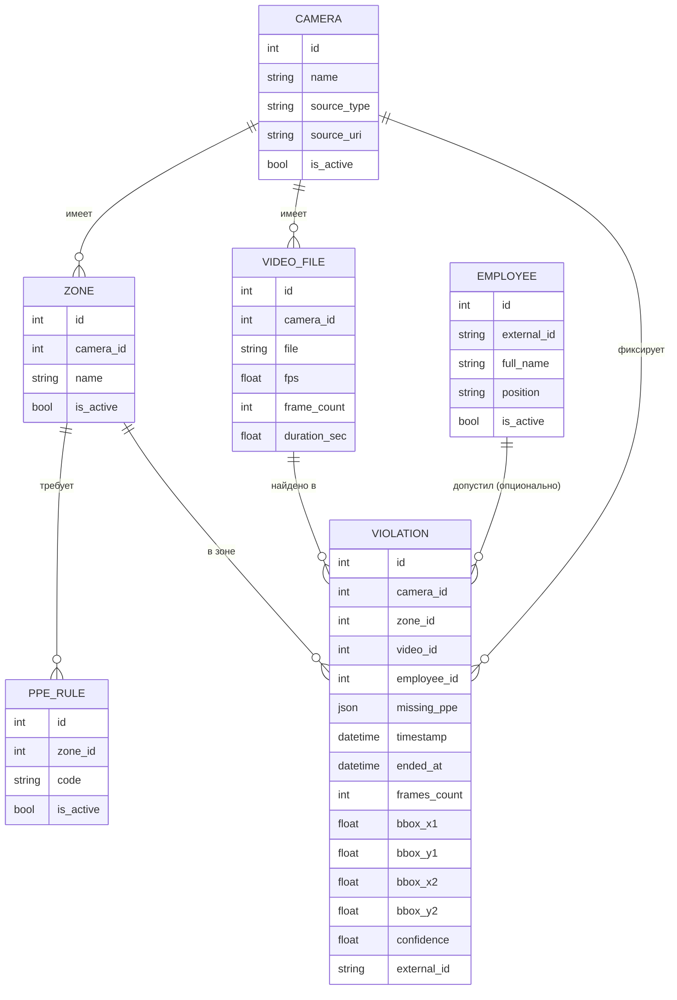

# ER-диаграмма

## Решения
- Коды нарушений: NO_HELMET, NO_VEST, NO_GLOVES.
- Одно непрерывное нарушение = одна запись `VIOLATION` (пауза больше 5 секунд начинает новую).
- Таблица Frames в MVP не создаётся: храним инциденты, а не каждый кадр. Если понадобится, добавим вместе с архивацией.
- `EMPLOYEE.external_id` уникален, по нему связываем с внешней системой (СКУД). Импорт из Excel в плане недели 2.
- Индексы: `VIOLATION(camera, -timestamp)`, `VIOLATION(zone, -timestamp)`, `timestamp`, `external_id`.